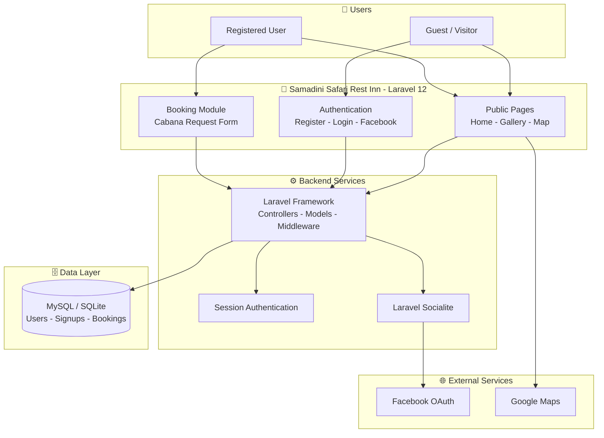
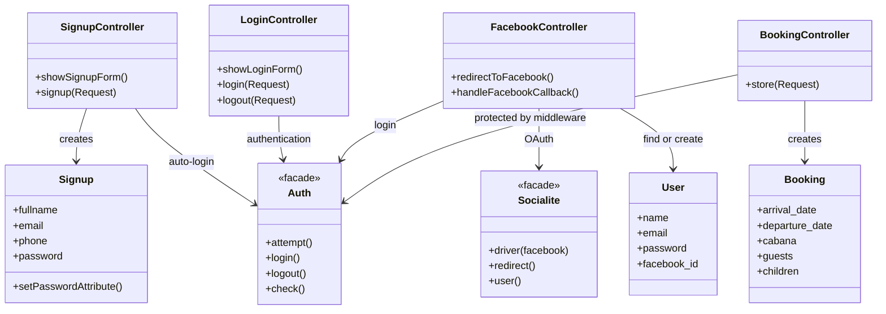
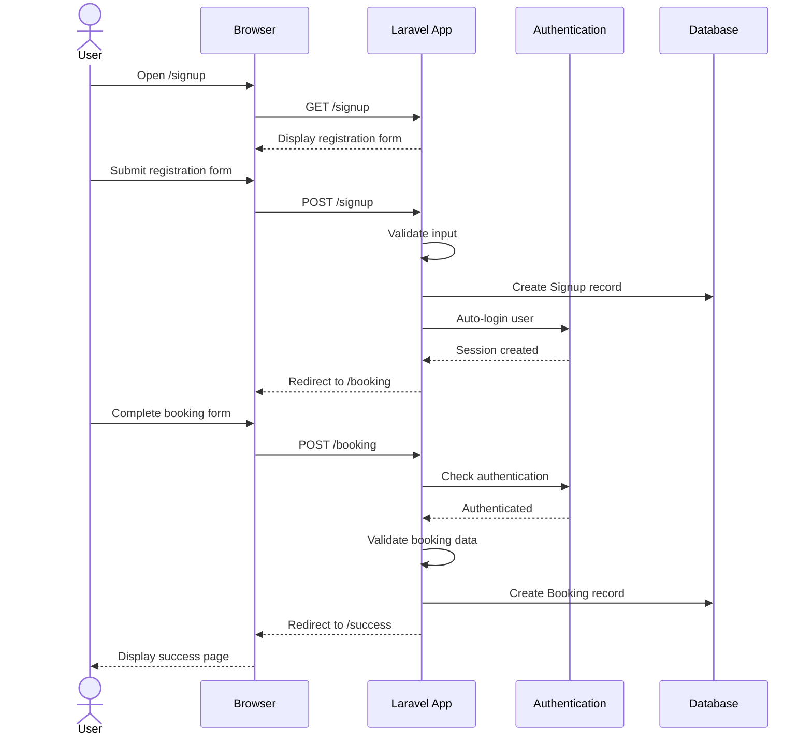
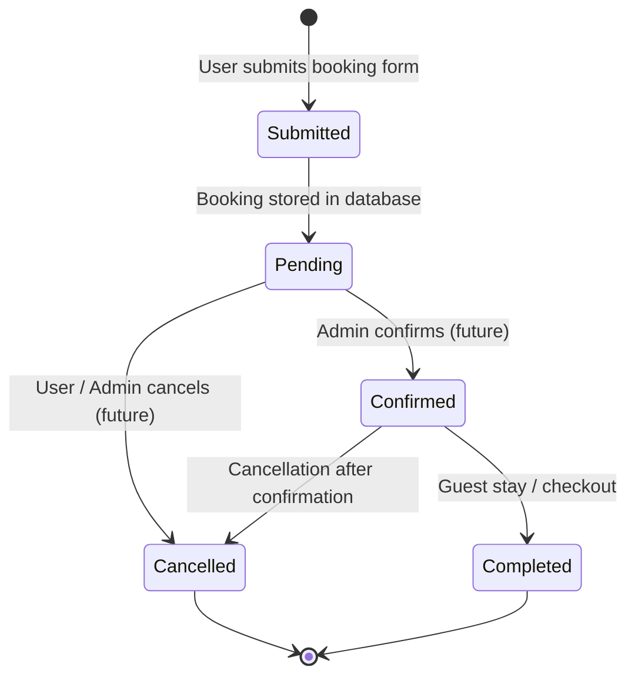
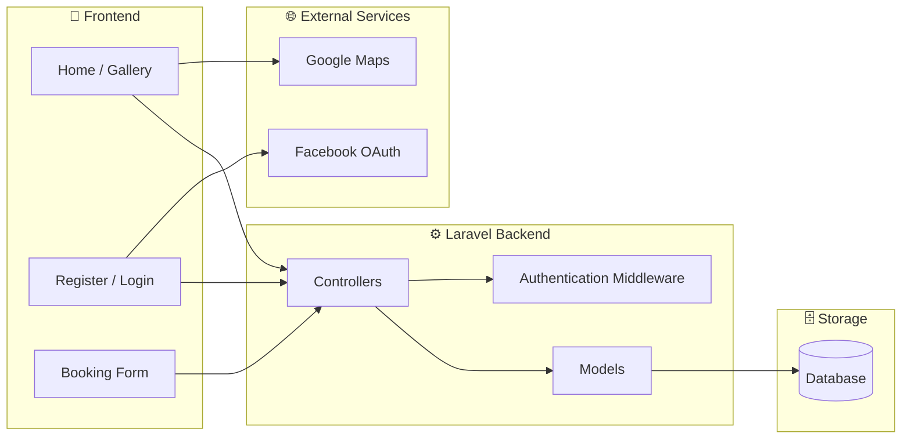

# 🏨 Samadini Safari Rest Inn

<p align="center">
  
  
  
  
</p>

<p align="center">
  
  
  
</p>

<p align="center">
  <strong>A Modern Web Application for Samadini Safari Rest Inn</strong>
  <br/>
  A Laravel-powered digital platform for exploring the property, user registration, and cabana booking requests.
</p>

---

## 🌿 About the Project

**Samadini Safari Rest Inn** is a web application developed using the Laravel framework to provide a modern digital experience for Samadini Safari Rest Inn.

Located approximately 2 km from Ampara town along the Ampara–Kandy main road, the property offers a peaceful environment for family holidays, romantic getaways, group trips, and comfortable dining experiences.

The application provides visitors with an online platform to explore the property, discover its facilities, register accounts, and submit cabana booking requests.

### 🎯 Project Objectives

- Establish a professional online presence for the property.
- Make property information easily accessible.
- Provide a convenient user registration and login experience.
- Allow authenticated users to submit cabana booking requests.
- Improve accessibility through responsive web design.
- Integrate external services such as Facebook Login and Google Maps.

> **Project Notice:** This is an academic and demonstration project. It is not a production-ready reservation platform. Additional security, testing, administrative booking management, and deployment configuration are required before real-world use.

---

## ✨ Key Features

### 🏠 Public Website

- Attractive homepage with fullscreen background video.
- About section introducing the property.
- Image gallery showcasing rooms and surroundings.
- Google Maps integration for location information.
- Contact information section.
- Responsive navigation and page layouts.

### 🔐 User Authentication

- User registration with full name, email, phone number, and password.
- Email and password login.
- Remember Me functionality.
- Facebook Login using Laravel Socialite.
- Session-based authentication.
- Protected booking routes for authenticated users.

### 🛏️ Cabana Booking

- Booking form accessible to authenticated users.
- Arrival and departure date selection.
- Cabana type selection.
- Number of adult guests.
- Number of children.
- Server-side form validation.
- Booking information stored in the database.
- Booking success page after submission.

### 🎨 User Interface

- Responsive Bootstrap-based layouts.
- Custom CSS branding.
- Clean navigation header.
- Consistent page styling.
- User-friendly forms and interface components.

---

## 🛠️ Technology Stack

| Category | Technologies |
|:---|:---|
| Backend Framework | Laravel 12 |
| Programming Language | PHP 8.2+ |
| Database | MySQL / SQLite |
| Authentication | Laravel Auth |
| Social Login | Laravel Socialite |
| Frontend | HTML5, CSS3, JavaScript |
| UI Framework | Bootstrap 4 / 5 |
| Icons | Font Awesome |
| Package Management | Composer |
| Version Control | Git & GitHub |

---

## 🏗️ System Architecture & Diagrams

The following diagrams illustrate the architecture, application modules, user interactions, and booking workflow of Samadini Safari Rest Inn.

### 1. System Architecture

<details>
<summary><strong>📊 Figure 1 – System Architecture</strong></summary>



</details>

### 2. Class / Module Diagram

<details>
<summary><strong>🧩 Figure 2 – Class / Module Diagram</strong></summary>



</details>

### 3. Sequence Diagram – User Registration & Booking

<details>
<summary><strong>🔄 Figure 3 – Registration and Cabana Booking Sequence</strong></summary>



</details>

### 4. Booking Request Status Lifecycle

<details>
<summary><strong>📋 Figure 4 – Booking Request Status Lifecycle</strong></summary>



**Current implementation flow:**

```text
User submits booking form
          |
          v
Booking saved in database
          |
          v
Success page displayed
```

**Future enhancements:** Booking confirmation, cancellation, and completion workflows require additional implementation.

</details>

### 5. High-Level Component View

<details>
<summary><strong>🧱 Figure 5 – High-Level Component View</strong></summary>



</details>

---

## 📁 Repository Structure

```text
samadinisafari/
│
├── app/
│   ├── Http/
│   │   └── Controllers/
│   │       ├── Auth/
│   │       │   └── FacebookController.php
│   │       ├── BookingController.php
│   │       ├── LoginController.php
│   │       └── SignupController.php
│   │
│   ├── Models/
│   │   ├── Booking.php
│   │   ├── Signup.php
│   │   └── User.php
│   │
│   └── Providers/
│
├── public/
│   ├── css/
│   ├── images/
│   └── videos/
│
├── resources/
│   └── views/
│
├── routes/
│   └── web.php
│
├── database/
├── config/
├── .env.example
├── artisan
├── composer.json
└── README.md
```

---

## ⚙️ Installation & Setup

### 📌 Prerequisites

Make sure the following tools are installed:

- PHP 8.2 or higher
- Composer
- MySQL or SQLite
- Node.js and npm (if frontend assets require building)
- Git
- Visual Studio Code or another code editor

### 1. Clone the Repository

```bash
git clone https://github.com/SHANALIKA/SamadiniSafari.git
```

```bash
cd SamadiniSafari
```

### 2. Install Dependencies

```bash
composer install
```

### 3. Configure Environment

Copy the example environment file:

```bash
cp .env.example .env
```

For Windows Command Prompt:

```cmd
copy .env.example .env
```

### 4. Generate Application Key

```bash
php artisan key:generate
```

### 5. Configure Database

Update your `.env` file with your database configuration:

```env
DB_CONNECTION=mysql
DB_HOST=127.0.0.1
DB_PORT=3306
DB_DATABASE=samadinisafari
DB_USERNAME=root
DB_PASSWORD=
```

Create the database using your database management tool before running migrations.

### 6. Run Migrations

```bash
php artisan migrate
```

### 7. Start the Development Server

```bash
php artisan serve
```

Open the application in your browser:

```text
http://127.0.0.1:8000
```

---

## 🔵 Facebook Login Configuration

The application uses Laravel Socialite for Facebook OAuth authentication.

To configure Facebook Login:

1. Create an application through the [Meta for Developers](https://developers.facebook.com/) platform.
2. Configure Facebook Login for the application.
3. Add the appropriate redirect URI.
4. Configure the Facebook credentials in the `.env` file.

Example:

```env
FACEBOOK_CLIENT_ID=your_facebook_app_id
FACEBOOK_CLIENT_SECRET=your_facebook_app_secret
FACEBOOK_REDIRECT_URI=http://127.0.0.1:8000/login/facebook/callback
```

> Never commit real Facebook credentials or private API keys to GitHub.

---

## 🔐 Security Considerations

- Passwords should be stored using secure hashing.
- Authentication middleware protects booking routes.
- Server-side validation should be applied to all user inputs.
- Sensitive credentials must be stored in environment variables.
- `.env` files should never be committed.
- Database access should follow appropriate security practices.
- Production deployment requires HTTPS and additional security testing.

---

## 🚀 Future Improvements

The following features could improve the application in future versions:

- [ ] Admin dashboard for managing reservations.
- [ ] Booking approval and rejection workflow.
- [ ] Booking availability calendar.
- [ ] Email confirmation notifications.
- [ ] Online payment integration.
- [ ] User booking history.
- [ ] Automated booking status updates.
- [ ] Improved form validation and error handling.
- [ ] Production deployment and security hardening.

---

## 🤝 Contributing

Contributions and suggestions are welcome.

1. Fork the repository.
2. Create a new feature branch.
3. Make your changes.
4. Test the updated functionality.
5. Commit your changes.
6. Submit a Pull Request.

---

## 👩‍💻 Developer

<p align="center">
  <strong>Shanalika Samadini</strong>
  <br/>
  Software Engineering Undergraduate | Web Developer
  <br/><br/>
  <a href="https://github.com/SHANALIKA">
    
  </a>
  <a href="https://www.linkedin.com/in/shanalika-samadini-571020204/">
    
  </a>
</p>

---

<p align="center">
  <strong>🏨 Samadini Safari Rest Inn</strong>
  <br/>
  <em>Just relaxing, chilling, and making happy memories — home away from home.</em>
  <br/><br/>
  <sub>Developed with ❤️ using Laravel & PHP</sub>
</p>
